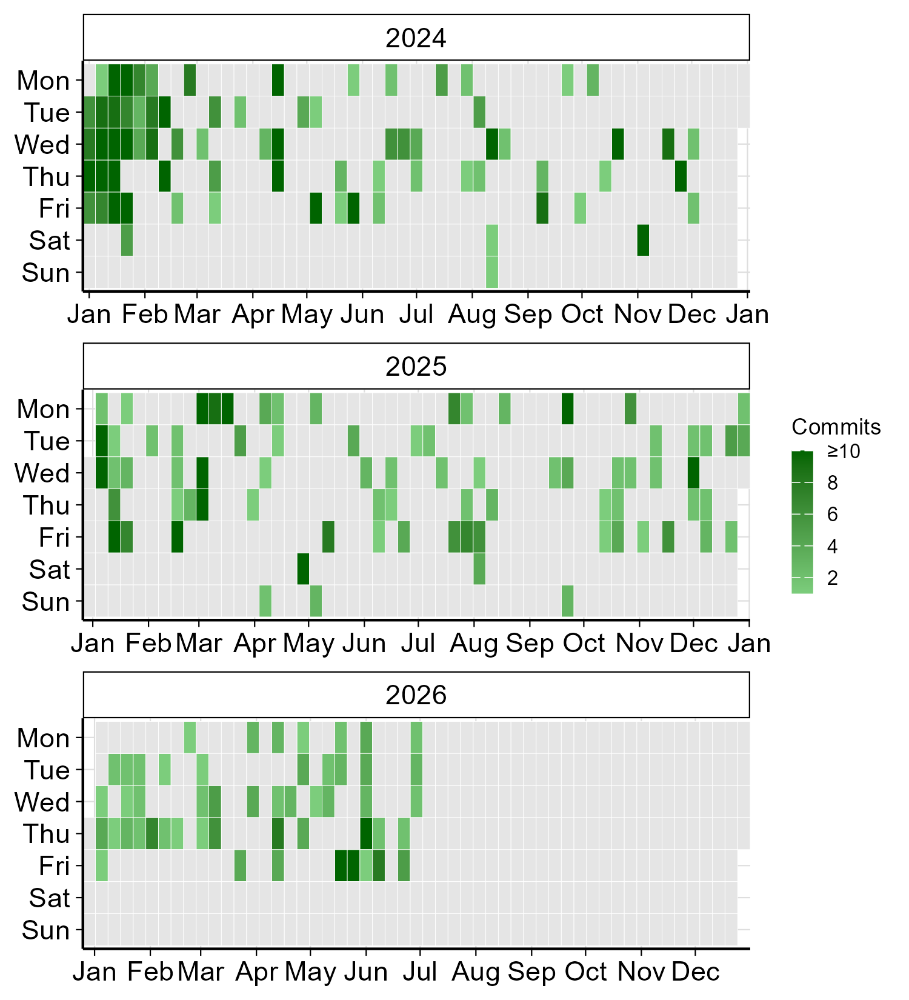

## Hi there 👋

I am Nataliya - a bioinformatician and biostatistician and currently I am: 

- Working on reproducible biomedical data analysis and reporting workflows
- Learning more about scalable pipelines and clinical data standards
- Open to bioinformatics, omics, biostatistics, and life-science data science collaborations

### Additional programming activity

Some of my coding work is in privated repositories. The plot below summarises my anonymised Git activity outside this profile.

Last updated: 25th October 2026
