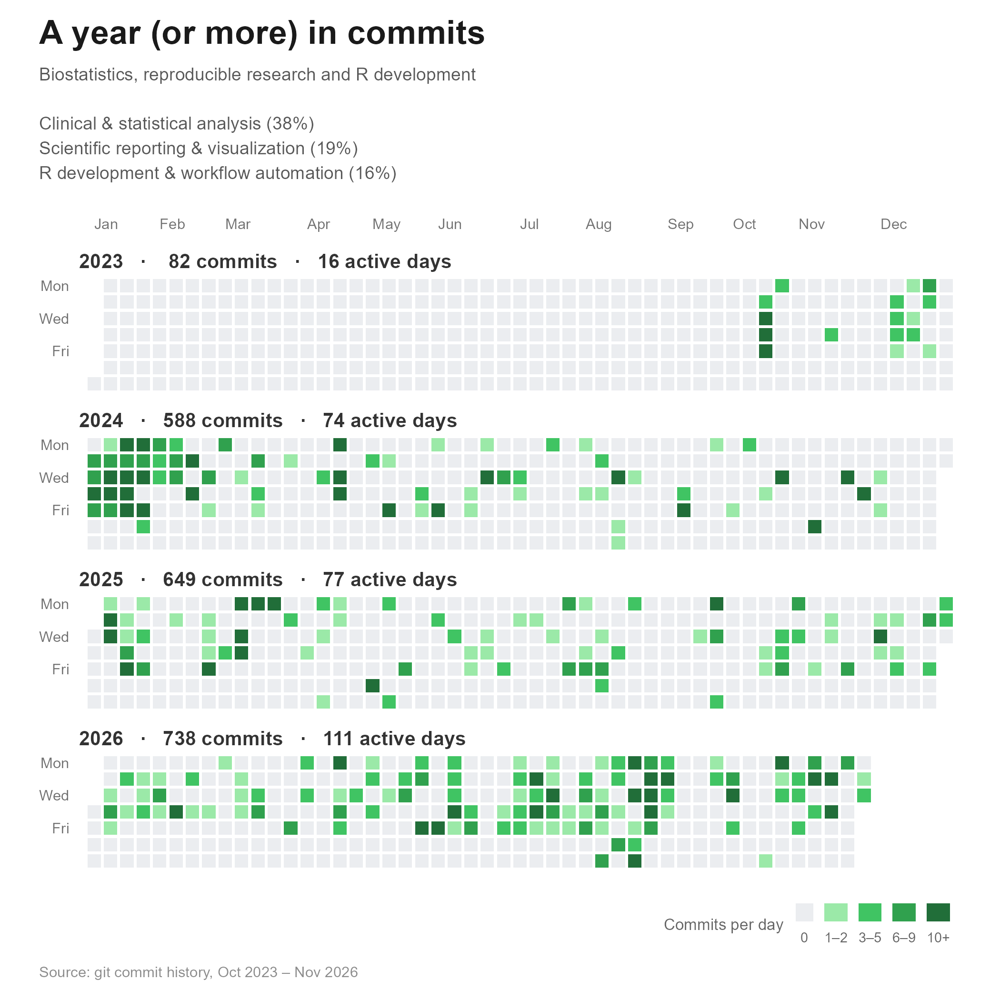

## Hi there 👋

I am Nataliya, a bioinformatician and biostatistician working at the
intersection of biomedical research, statistics and reproducible computing.

My work focuses on:

- Clinical and statistical analysis of biomedical data
- Bioinformatics, omics and quantitative biology
- Reproducible research and automated analytical workflows in R
- Translating complex datasets into meaningful scientific insights

I am particularly interested in scalable analytical pipelines,
clinical data standards and interdisciplinary life-science research.

### Beyond public repositories

Much of my professional coding takes place in private repositories.
The visualization below provides a glimpse into my ongoing work in
statistical analysis, scientific reporting and workflow automation,
without exposing confidential research data or source code.

Last updated: 25th November 2026
